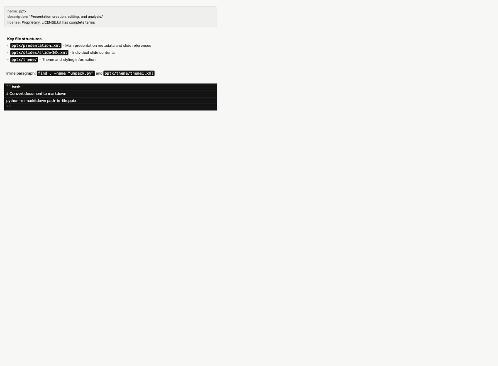
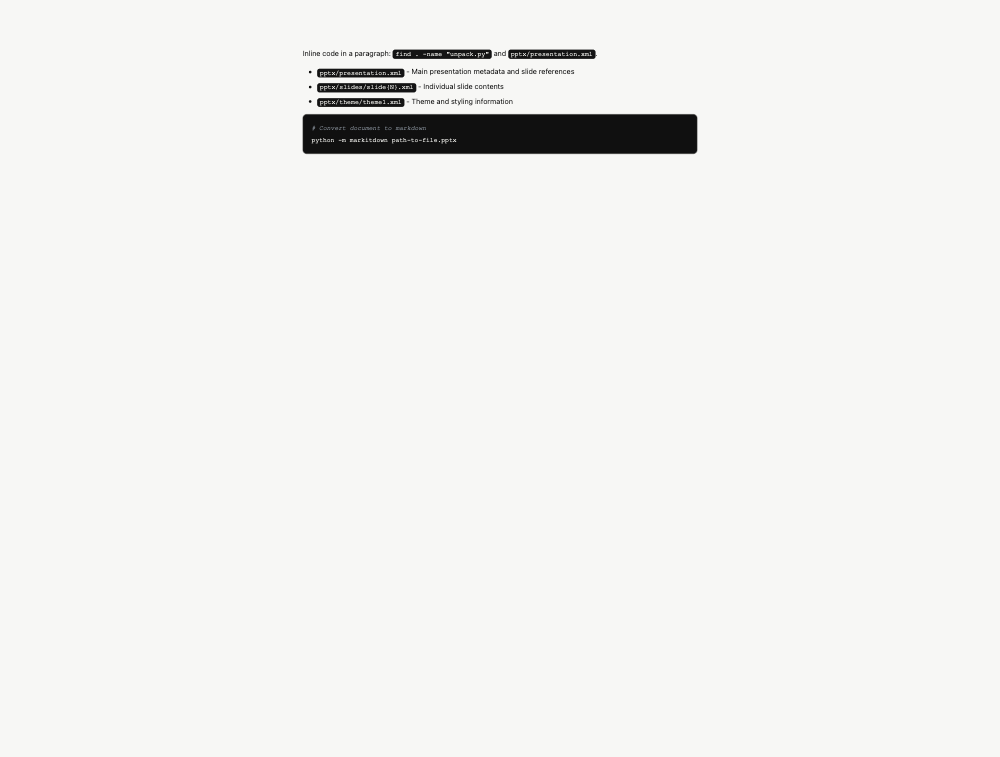

# fix-theme-wudang_code-invisible-black-on-black

## 问题

论道武当主题下，阅读模式与实时模式的代码块/行内代码出现黑底黑字，文字不可见（截图红框与黑块）。

## 环境

| 项 | 值 |
|----|----|
| git commit | 739cf43 |
| 分支 | feat/wysiwyg |
| 平台 | darwin |
| 建档时间 | 2026-10-31T20:47:10+08:00 |
| 会话 | ses_e6ef099edffeeWN6cOO3eqBvUE |

## 调查过程

- [20:47] 建档
- [21:09] 记录日志 (chat): 根因: 论道武当是浅色主题但代码面是深色, 语法 token 仍用浅色方案且 pre code 继承了 --text(墨黑), 导致黑底黑字; 实时模式 frontmatter 只有半透明行样式, 未做卡片格式化。
- [21:15] 新增 E2E 用例: 论道武当主题：阅读模式代码块文字可见
- [21:15] 新增 E2E 用例: 论道武当主题：实时模式代码块与行内代码可见
- [21:15] 新增 E2E 用例: 实时模式 frontmatter 显示为卡片
- [21:16] 记录证据 2 项
- [21:16] 记录日志 (bash): 修复后前端 365 项通过、Rust 98 项通过（2 项为仓库已知 Windows 路径用例在 macOS 失败）。
- [21:16] 记录证据 1 项
- [21:16] 记录终端文本快照
- [21:16] 结案
- [21:20] 记录日志 (bash): 全主题对比度审计：仅论道武当存在『浅色 scheme + 深色代码面』错配；其余主题代码文字对比度均 ≥4.7。另发现导出 HTML 的深色 --syn-variable 误用浅色值，已修。

## 日志与摘录

### [chat] 2026-10-31T21:09:32+08:00 · 根因: 论道武当是浅色主题但代码面是深色, 语法 token 仍用浅色方案且 pre code 继承了 --text(墨黑), 导致黑底黑字; 实时模式 frontmatter 只有半透明行样式, 未做卡片格式化。

```
wudang.json: dark=false, --code-bg=#141414, --pre-bg=#101010, --code-text=#f2f2ee
md-content.css: .md-body pre code { color: var(--text) } -> #1a1a1a on #101010 (invisible)
index.css: :root[data-scheme=light] 提供深色 --syn-* 语法色, wudang 的深色代码面没有覆盖
livePreview.ts: frontmatter 只加 rk-frontmatter 半透明, 围栏与 key/value 未格式化; SetextHeading2 可能把元信息行渲染成标题
```

### [bash] 2026-10-31T21:16:44+08:00 · 修复后前端 365 项通过、Rust 98 项通过（2 项为仓库已知 Windows 路径用例在 macOS 失败）。

```
pnpm exec tsc --noEmit: clean
pnpm test: 23 files / 365 tests passed
cargo test: 98 passed; 2 failed (core::fsops::inside_root_guard, core::markdown::img_rewrite_resolves_parent_climbs — 已知 Windows-only 用例)
browser computed: .md-body pre code color rgb(242,242,238) on rgb(16,16,16); .md-body li code color rgb(242,242,238) on rgb(20,20,20); live .rk-code color rgb(242,242,238) on rgb(20,20,20)
```

### [bash] 2026-10-31T21:20:18+08:00 · 全主题对比度审计：仅论道武当存在『浅色 scheme + 深色代码面』错配；其余主题代码文字对比度均 ≥4.7。另发现导出 HTML 的深色 --syn-variable 误用浅色值，已修。

```
code-text/code-bg 与 code-text/pre-bg 对比度：赛博朋克 11.63/13.71、暗色 5.21/6.59、石墨 7.01/8.65、浅色 14.09/14.84、高山流水 6.25/6.43、陈旧报纸 5.91/5.97、魅影紫罗兰 8.95/10.77、青梅煮酒 5.07/5.17、蓝天白云 6.13/6.41、夕阳海岸 4.77/4.98、无边绿意 5.73/6.01、论道武当 16.41/16.95。
scheme/pre-bg 错配：仅 wudang（dark=false, pre-luma=0.01）；其余 light 主题 pre-bg 均浅色，dark 主题 pre-bg 均深色。
所有主题按各自 data-scheme 的 --syn-* 在 pre-bg 上对比度均 ≥3.0；wudang 已补深色调色板。
附带发现：export.rs 深色 --syn-variable 为 #0550ae（浅色值），在深色 pre-bg 上对比度不足；已改为 #79c0ff 并加单测。
次要：部分浅色主题 --muted/--panel 对比度 3.05–3.63（青梅煮酒 3.08、夕阳海岸 3.05），frontmatter 键名与 quote 文本偏低但可读，属既有视觉取舍，本次不改。
```

## 测试场景与 E2E 用例

| # | 用例 | 步骤 | 预期 | 结果 |
|---|------|------|------|------|
| 1 | 论道武当主题：阅读模式代码块文字可见 | 切到论道武当；打开含 fenced code block 与行内代码的 Markdown；阅读模式 | 代码块浅色文字显示在深色背景上，行内代码同样可见 | pass（浏览器复现：pre code color=#f2f2ee on #101010） |
| 2 | 论道武当主题：实时模式代码块与行内代码可见 | 切到论道武当；实时视图；含 fenced code block 与行内代码的文档 | 代码块与行内代码均为浅色文字 + 深色底 | pass（浏览器复现：rk-code / rk-inline-code color=#f2f2ee） |
| 3 | 实时模式 frontmatter 显示为卡片 | 实时视图；文档以 --- frontmatter 开头；光标移出 frontmatter | 首尾 --- 隐藏，元信息行有卡片背景，键名弱化、值正常着色；光标进入时恢复原文 | pass（浏览器复现：rk-fm-line / rk-fm-key / rk-fm-val） |

## 证据截图





[文本快照: E2E 验证快照（浏览器 computed style 与测试结果）](shots/003-211654.txt)

## 修复方案

1) md-content.css 的 .md-body pre code 从 --text 改为 --code-text；2) wudang.json 补齐深色 --syn-* 调色板，避免浅色 scheme 的深色 token 落在深色代码面上；3) 导出 HTML 增加 data-theme 与主题级 --syn-* 覆盖（在 scheme 调色板之后，保证优先级）；4) 实时模式 .rk-code / .rk-inline-code 显式使用 --code-text；5) 实时 frontmatter 从半透明行样式改为卡片：隐藏首尾 --- 并折叠行高、内容行背景卡片化、键名弱化、值正常着色；同时把 frontmatter 守卫改为跳过重叠节点但不跳过 Document 根，修复了有 frontmatter 时整篇实时装饰被跳过的问题。

## 复盘

主题的 dark 字段只描述整体明暗，不能代表代码面明暗；浅色主题完全可以有深色代码块。判断语法调色板应看代码面亮度，主题作者必须在 JSON 中覆盖 --syn-*。实时 frontmatter 不能用 block widget（CM6 禁止 ViewPlugin 提供 block 装饰），行装饰卡片是可行替代。装饰遍历的前置守卫要区分根节点，否则一个 intersects 会把整棵树剪掉。
