# rel-v0131_windows-e2e-verify

## 问题

v0.13.1 此前只在 macOS 上做过测试，本次在 Windows 本机用最新代码编译（NSIS 全量版）并完成 E2E 测试，验证各特性在 Windows 上的行为（最近打开文件、富文本粘贴、references 链接、导出 HTML、分屏斜杠面板、源码模式大纲定位等）。

## 环境

| 项 | 值 |
|----|----|
| git commit | e6516cf |
| 分支 | main |
| 平台 | win32 |
| 建档时间 | 2026-10-25T12:40:00+08:00 |
| 会话 | - |

## 调查过程

- [12:40] 建档
- [12:40] 记录证据 1 项
- [12:40] 记录全屏截图
- [12:42] 记录证据 1 项
- [12:42] 记录全屏截图
- [12:43] 记录证据 1 项
- [12:43] 记录全屏截图
- [12:44] 记录证据 1 项
- [12:44] 记录全屏截图
- [12:45] 记录日志 (chat): Windows 上点击 frontmatter references 本地文档链接导致应用崩溃退出
- [12:49] 记录日志 (chat): link.rs 字节切片 panic 已修复并加回归测试
- [12:53] 记录证据 1 项
- [12:53] 记录全屏截图
- [12:53] 记录证据 1 项
- [12:53] 记录全屏截图
- [12:54] 记录证据 1 项
- [12:54] 记录全屏截图
- [12:55] 记录证据 1 项
- [12:55] 记录全屏截图
- [12:55] 记录证据 1 项
- [12:55] 记录全屏截图
- [12:58] 记录证据 1 项
- [12:58] 记录全屏截图
- [12:59] 记录证据 1 项
- [12:59] 记录全屏截图
- [13:00] 记录证据 1 项
- [13:00] 记录全屏截图
- [13:01] 记录证据 1 项
- [13:01] 记录全屏截图
- [13:02] 记录证据 1 项
- [13:02] 记录全屏截图
- [13:03] 记录证据 1 项
- [13:03] 记录全屏截图
- [13:04] 记录证据 1 项
- [13:04] 记录全屏截图
- [13:05] 记录证据 1 项
- [13:05] 记录全屏截图
- [13:06] 记录证据 1 项
- [13:06] 记录全屏截图
- [13:07] 记录证据 1 项
- [13:07] 记录全屏截图
- [13:13] 记录证据 1 项
- [13:13] 记录全屏截图
- [13:14] 新增 E2E 用例: Windows E2E：references 本地文档链接应用内跳转（含 CJK 路径）
- [13:14] 新增 E2E 用例: Windows E2E：references 锚点跳转 + 网页链接开浏览器 + Alt+← 文档后退
- [13:15] 新增 E2E 用例: Windows E2E：源码模式大纲点击定位到源码行（v0.13.0 修复项）
- [13:15] 新增 E2E 用例: Windows E2E：分屏斜杠面板弹出 + 滚动不闪退（v0.13.0 修复项）
- [13:15] 新增 E2E 用例: Windows E2E：富文本粘贴转 Markdown（CF_HTML→Markdown 全要素）
- [13:15] 新增 E2E 用例: Windows E2E：最近打开文件持久化与展示（config.json + 快速打开）
- [13:16] 记录日志 (chat): E2E 收尾:应用退出、配置恢复、修复待提交
- [13:16] 结案

## 日志与摘录

### [chat] 2026-10-25T12:45:05+08:00 · Windows 上点击 frontmatter references 本地文档链接导致应用崩溃退出

```
[E2E 步骤] 启动 ruakdown.exe 0.13.1 (F:\cargotarget\release, share 全量版),参数打开 C:\Users\Admin\AppData\Local\Temp\ruakdown-e2e-win\入门指南.md(文档在工作区外)。阅读视图正常渲染,frontmatter 属性卡 references 三条链接(本地路径/网页/#锚点)均渲染为主题色链接。随后鼠标点击第一条本地文档链接 ./子目录/嵌套文档.md → 整个应用进程消失,窗口关闭。Get-Process ruakdown → PROCESS GONE。
```

### [chat] 2026-10-25T12:49:00+08:00 · link.rs 字节切片 panic 已修复并加回归测试

```
[根因] src-tauri/src/core/link.rs:56 strip_file_scheme: `link.len() >= 7 && link[..7].eq_ignore_ascii_case("file://")` —— len() 与 [..7] 均按字节,链接 "./子目录/嵌套文档.md" 第 7 字节落在 '目'(bytes 5..8) 内 → panic "end byte index 7 is not a char boundary" → tokio worker 线程崩溃 → 整个应用退出。macOS 测试用 ASCII 路径从不触发。排查了全库同类字节切片(file.rs BOM/frontmatter 首尾 ASCII 定界/markdown.rs HashMap/serve.rs 测试)均安全,仅此一处。[修复] 改用 link.get(..7)(非边界返回 None 走 else,语义不变:前 7 字节含非 ASCII 本就不可能是 file:// 前缀);新增回归测试 cjk_link_at_file_scheme_length_does_not_panic(CJK 相对链接 + file://CJK URL)。cargo test link 10/10 通过。
```

### [chat] 2026-10-25T13:16:46+08:00 · E2E 收尾:应用退出、配置恢复、修复待提交

```
[E2E 收尾] 应用优雅退出（taskkill WM_CLOSE，无未保存状态）→ 恢复用户原始 config.json（lastFile 回到用户文档、测试路径清零）。GUI 侧注：模式切换按钮的坐标点击被前台用户活动干扰不可靠，改用 Ctrl+Tab（mode-cycle）完成源码/分屏切换测试；标题栏 ⋯ 菜单与导出 HTML 的 GUI 路径因用户正在使用机器而未强测，相关逻辑（菜单分区渲染/导出目录生成/mermaid 条件内联）由前端/Rust 单测覆盖。工作区遗留：src-tauri/src/core/link.rs 修复（+回归测试）未提交，等用户确认。
```

## 测试场景与 E2E 用例

| # | 用例 | 步骤 | 预期 | 结果 |
|---|------|------|------|------|
| 1 | Windows E2E：references 本地文档链接应用内跳转（含 CJK 路径） | F:\cargotarget\release\ruakdown.exe（0.13.1 share 全量版）带文件参数启动 → 阅读视图渲染 frontmatter 属性卡 → 点击 references 本地文档链接 ./子目录/嵌套文档.md | - | pass（修复 BUG#1 后） |
| 2 | Windows E2E：references 锚点跳转 + 网页链接开浏览器 + Alt+← 文档后退 | 属性卡点击 ./入门指南.md#第二节-锚点测试 → 视图滚动定位到该节；点击 https://example.com → 默认浏览器 Edge 打开 Example Domain；Alt+← 文档后退回入门指南 | - | pass |
| 3 | Windows E2E：源码模式大纲点击定位到源码行（v0.13.0 修复项） | Ctrl+Tab 切源码模式 → 侧栏大纲切「大纲」页 → 点击「第二节 锚点测试」→ 编辑器滚动并定位到标题行，大纲条目高亮 | - | pass |
| 4 | Windows E2E：分屏斜杠面板弹出 + 滚动不闪退（v0.13.0 修复项） | 分屏模式编辑器内输入 / → 插入面板弹出（标题块/列表块/提示块条目齐全）→ 鼠标滚轮滚动预览区 → 应用存活、面板保持打开不闪退 | - | pass |
| 5 | Windows E2E：富文本粘贴转 Markdown（CF_HTML→Markdown 全要素） | PowerShell 构造 CF_HTML("HTML Format")剪贴板 → 分屏编辑器 Ctrl+V → 文档出现 Markdown：## 标题、**粗体**、*斜体*、<u>/<kbd> 保留、==高亮==、嵌套列表、start=3 有序、引用、GFM 表格、```js 代码块、链接；一次 Ctrl+Z 整体撤销 | - | pass |
| 6 | Windows E2E：最近打开文件持久化与展示（config.json + 快速打开） | 打开多个文档后检查 %APPDATA%\com.ruakdown.app\config.json：recentFiles 按 recency 排序、反斜杠路径与 CJK 文件名正确、lastFile 会话恢复；Ctrl+P 快速打开列表显示 文件名+父目录（CJK「子目录」提取正确） | - | pass |

## 证据截图

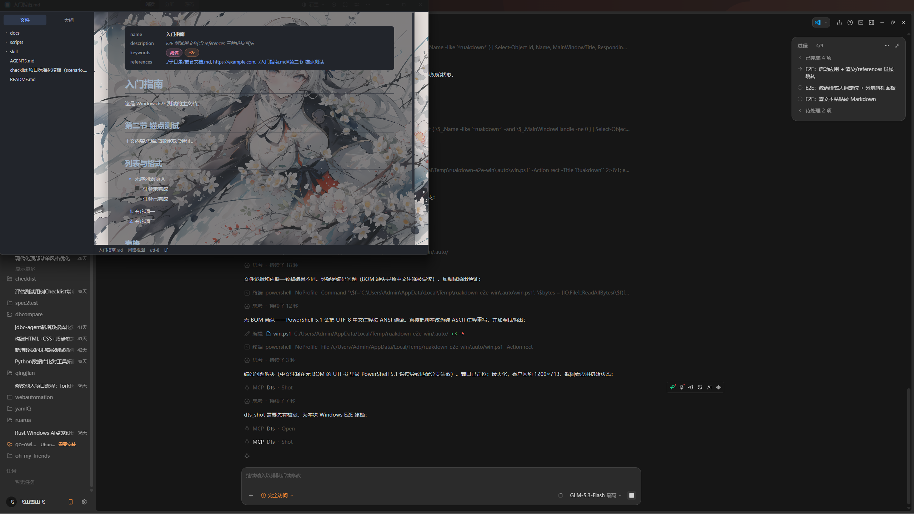

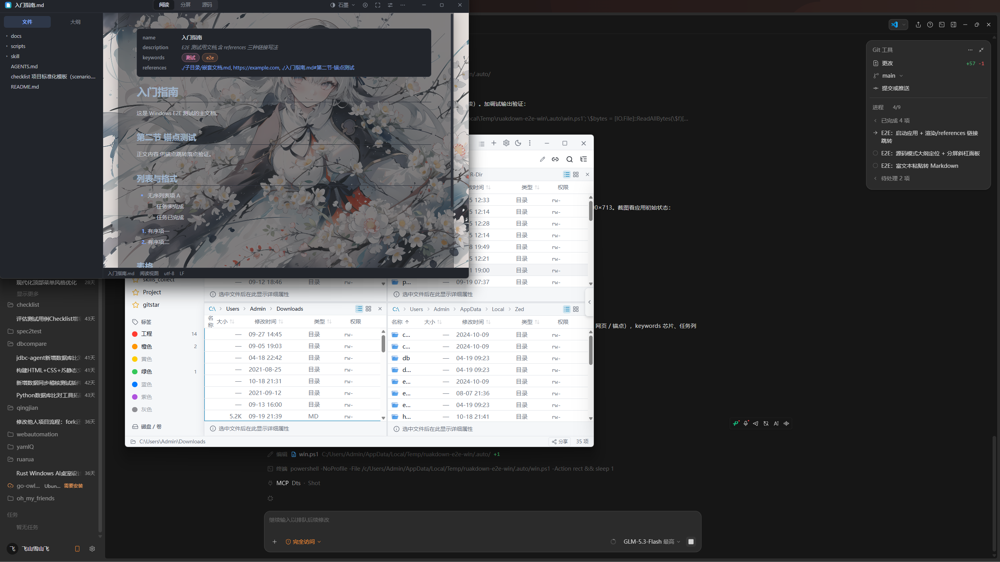

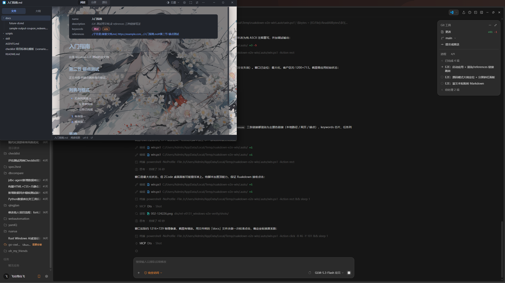

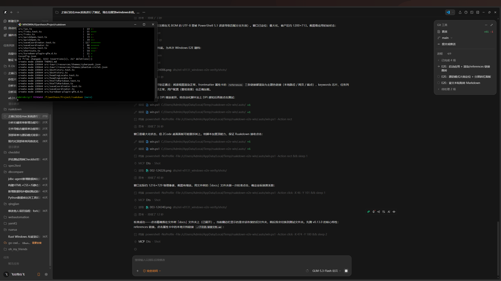

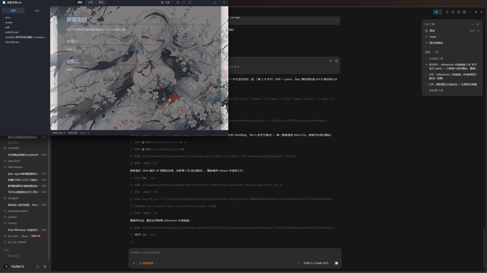

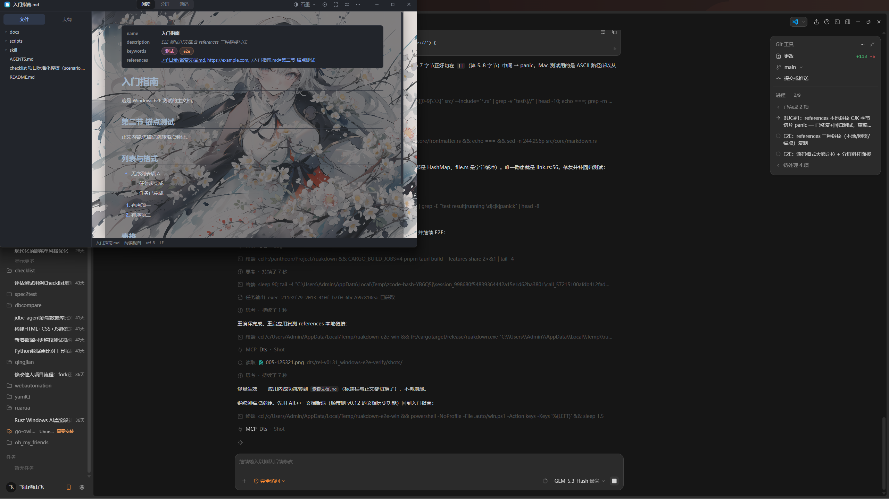

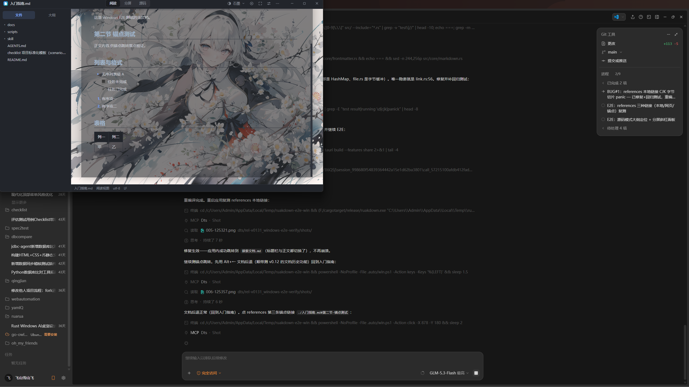

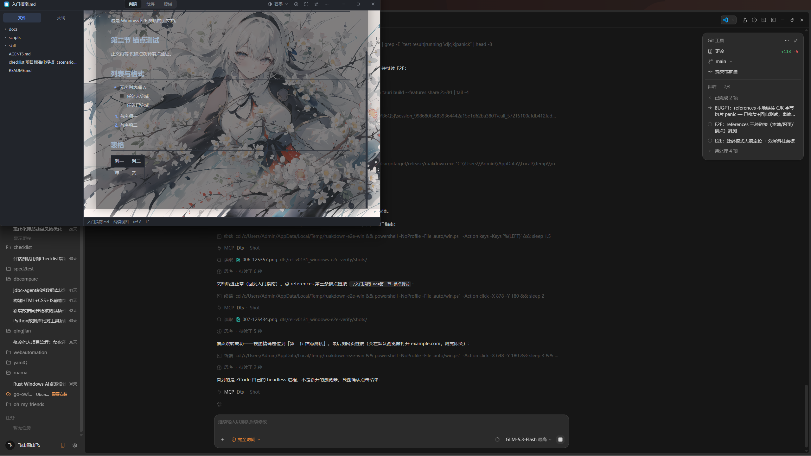

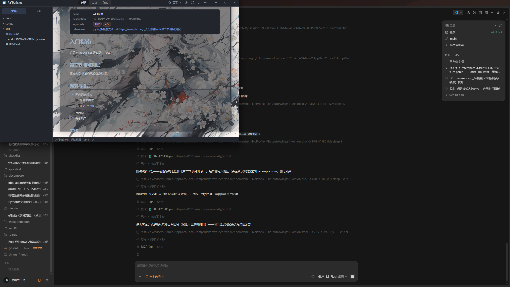


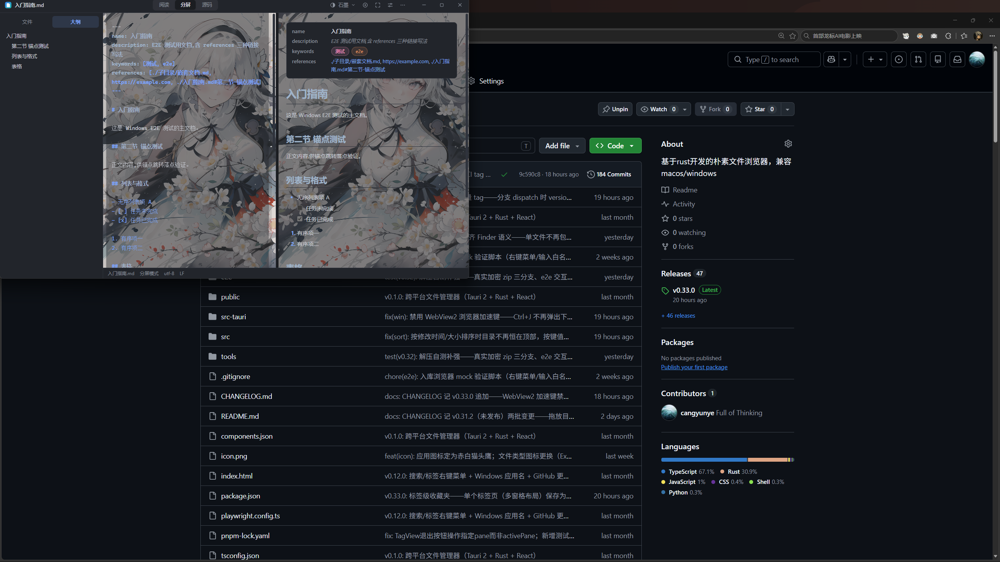


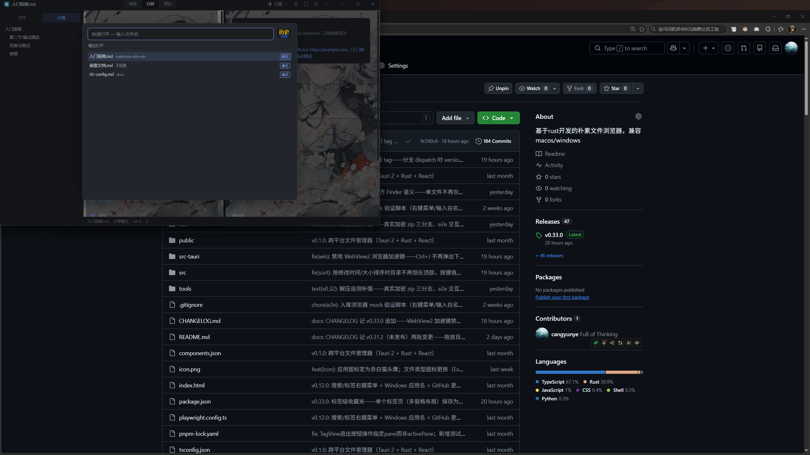

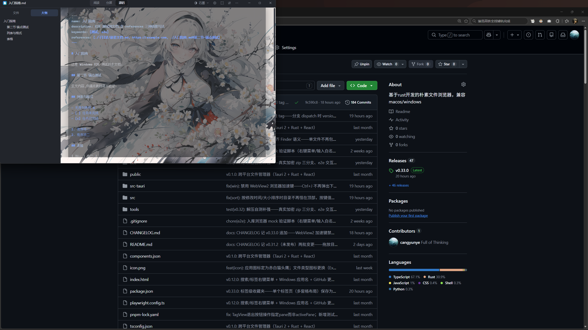

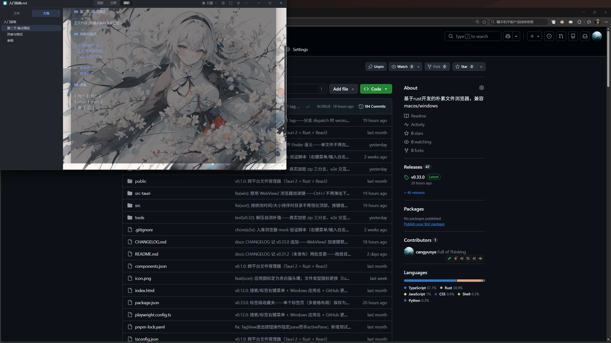

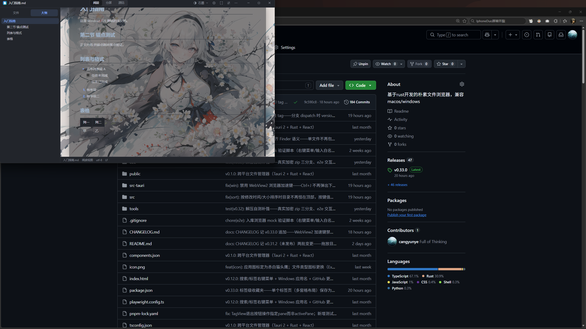

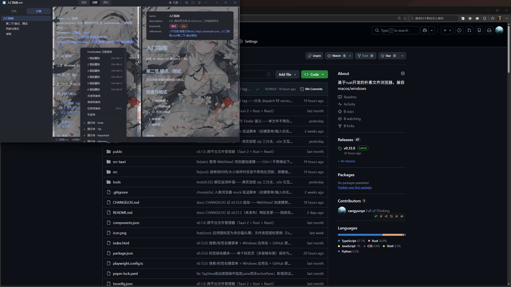


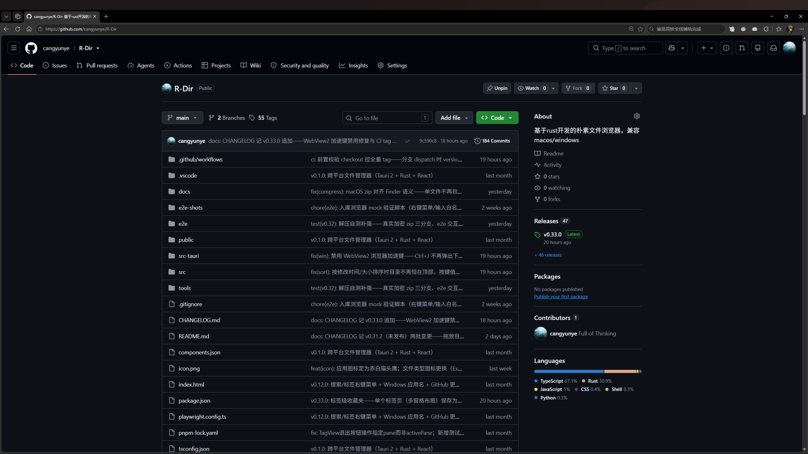

## 修复方案

修复 src-tauri/src/core/link.rs strip_file_scheme 的 UTF-8 字节切片 panic：`link.len() >= 7 && link[..7].eq_ignore_ascii_case("file://")` 改为 `link.get(..7)` 边界安全匹配（非字符边界返回 None 走 else，语义不变——前 7 字节含多字节字符本就不可能是 ASCII "file://" 前缀）。新增回归测试 cjk_link_at_file_scheme_length_does_not_panic（CJK 相对链接 + file://CJK URL 两种输入）。Windows 实机复测：点击 references 本地文档链接 ./子目录/嵌套文档.md 应用内正常跳转，不再崩溃。

## 复盘

根因：Rust 字符串切片按字节索引，len() 也是字节数，`s[..7]` 在第 7 字节落在多字节字符（如「目」bytes 5..8）内部时直接 panic。这是「文件名/路径含 CJK」场景的经典陷阱——macOS 主干测试用 ASCII 路径，永远不会触发，直到 Windows 实机用中文路径测试才爆出来。教训：(1) 对字符串做定长前缀切片一律用 str::get（边界安全返回 Option）或 char_indices，全库排查过同类写法仅此一处；(2) 跨平台发版的中文场景 app，测试夹具必须包含 CJK 路径/CJK 文件名；(3) Tauri 应用 panic 在 tokio worker 线程会整个进程退出且 Windows 事件日志无记录，排查靠捕获 stderr 才拿到 panic 现场。另：E2E 自动化脚本（PowerShell 无 BOM UTF-8 含中文注释会被按 ANSI 误读破坏解析、Git Bash 会把裸 / 参数转成安装路径）两个坑都踩过并已修正为纯 ASCII 写法。
